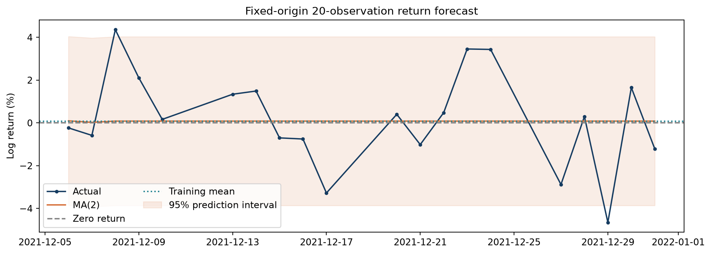
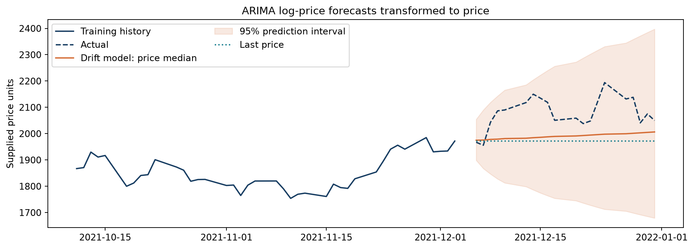

# Equity Time-Series Forecasting

**ARMA/ARIMA selection, residual diagnostics, and honest benchmark evaluation**

`Python` · `statsmodels` · `fixed-origin holdout` · `fully re-executed on every run`

---

## Headline

On a 2,911-observation daily price series (2010-01-04 to 2021-12-31), training-only
BIC selects **MA(2)**. Against an untouched 20-observation holdout it beats a
zero-return forecast by **0.29% of RMSE** — and residual diagnostics reject
adequacy at lag 20.

The point of the project is that **both halves of that sentence matter**. A 0.29%
RMSE edge on one window with 20 points is not evidence of a usable model, and
reporting it as such is the most common failure in student forecasting work.

## Research question

Can a parsimonious linear time-series model improve on a trivial forecast of this
price series? The study deliberately keeps three questions apart that are often
collapsed into one:

1. how well the model *fits* (information criteria),
2. whether its residuals are *adequate* (Ljung-Box, ARCH-LM),
3. whether it *forecasts* better than a benchmark (holdout RMSE/MAE).

A model can win on (1) and still fail (2) and (3). Here it does.

## Design decisions that keep the result honest

| Decision | Why it matters |
| --- | --- |
| BIC selection is specified **before** the holdout is touched | Otherwise the "winner" is chosen by looking at the answer |
| One fixed-origin forecast of all 20 steps, parameters frozen | No refitting, no feeding realised values back in |
| First test return uses the **last training price** as its lag | A common off-by-one that silently leaks information |
| Benchmarks (zero return, training mean) fixed in advance | A model that cannot beat "no change" has not shown anything |
| Returns and log prices reported on separate scales | Their RMSEs answer different questions and are not comparable |
| Transform `exp(z/100)` labelled a price **median**, not a mean | The mean needs the variance correction `exp(σ²/20000)` |

## Results

Return forecast errors, in percentage points, same 20 held-out dates:

| Model | MAE | RMSE |
| --- | ---: | ---: |
| **MA(2)** | **1.713472** | **2.218777** |
| Zero return | 1.724269 | 2.225323 |
| Training mean | 1.715787 | 2.219527 |

Log-price forecast errors, on the `100·ln(P)` scale:

| Model | MAE_z | RMSE_z |
| --- | ---: | ---: |
| ARIMA(1,1,1) with drift | 4.531076 | 5.147919 |
| ARIMA(1,1,1) no drift | 5.395387 | 5.983584 |
| Last value | 5.429544 | 6.021481 |

Residual diagnostics for MA(2): Ljung-Box *p* = 0.1640 at lag 10 (do not reject)
but 0.0275 at lag 20 (**reject**). The 10-lag ARCH-LM *p* = 4.0e-09 rejects
no-ARCH. So the BIC winner is a provisional comparison model with detectable
remaining structure and clear volatility clustering — not a final specification.





## What I would do differently with more time

Pre-register an expanding-window evaluation over several non-overlapping origins,
nest model selection inside the training folds, verify the vendor and dividend
adjustment of the price series, and compare conditional-variance models with
calibrated prediction intervals. These are stated as next steps, not as results
I am claiming.

## Reproduce

```bash
pip install -r requirements.txt
python run_analysis.py
```

`run_analysis.py` is a verifier, not just a runner. It

1. checks the SHA-256 of every input file against `provenance.json`,
2. clears all notebook outputs and re-executes the notebook from scratch,
3. fails if any cell errors,
4. compares every regenerated number against `reference_results.json` at
   `rtol=1e-6`,
5. re-exports the HTML report and rewrites `MANIFEST_SHA256.json`.

Keep the repository's root `portfolio_common/` directory alongside `projects/`;
the project entry point locates it without requiring `PYTHONPATH`. It can be
called from the project directory or by script path from another directory.
Before execution, exact package versions are checked against the read-only
`requirements.txt`. Missing packages or mismatches stop the run with a clear
error; actual versions and mismatches are recorded in `results/environment.json`,
including failed checks. The root-level `environment.json` is a historical
record and is not overwritten. `python run_analysis.py --check-only` checks
environment, input hashes, English source and source synchronization without
executing the notebook or certifying regenerated numbers.

`Research_Analysis.ipynb` is the canonical analysis. From the repository root,
use `python -B portfolio_common/notebook_source.py projects/01-equity-time-series-forecasting`
to regenerate `analysis.py`, or add `--check` to verify synchronization.
For edits made to the exported Python cells, `--update-notebook-code` explicitly
imports them into the notebook and clears stale outputs; it never executes the
analysis. The runner rejects an unsynchronized export. Full-training candidate
models are fitted once and reused for comparison, diagnostics, forecasts and
the 100% stability check; the 60% and 80% prefixes still receive separate fits.

Last verified run: **11 reference tables, 252 numeric values matched, 0 errors**
(see `results/verification.json`).

## Contents

- `Research_Analysis.ipynb` / `.html` — the executed analysis
- `REPORT.md` / `FIRST_READ.html` — the written report
- `analysis.py` — the analysis as a plain module
- `results/` — regenerated tables and figures
- `GZMTp.csv` — the input series (2,911 daily closes)
- `source_materials/` — the original course notebook and dataset, unmodified

## Provenance and limitations

Developed from supplied econometrics coursework; the original teaching notebook
and dataset are retained unmodified in `source_materials/` for comparison. The
data were provided with the course: the upstream vendor, adjustment policy and
dividend treatment were **not** independently verified, so the study describes
the supplied closing-price series rather than a total-return investment. AI
assistance was used for code completion, analytical organisation, verification
and English writing; the analytical design, the decisions in the table above and
all interpretation are my own.
