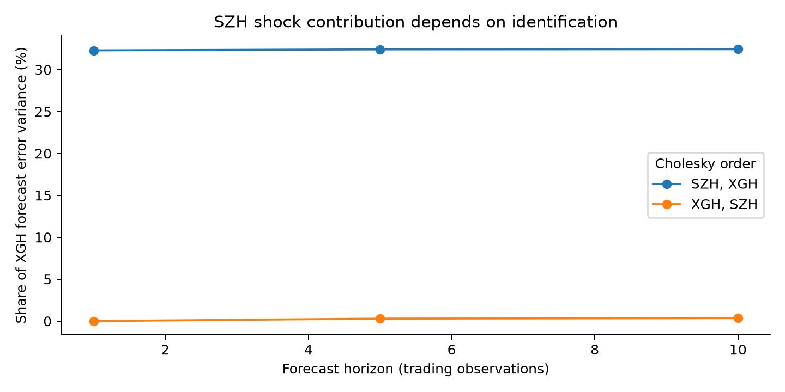
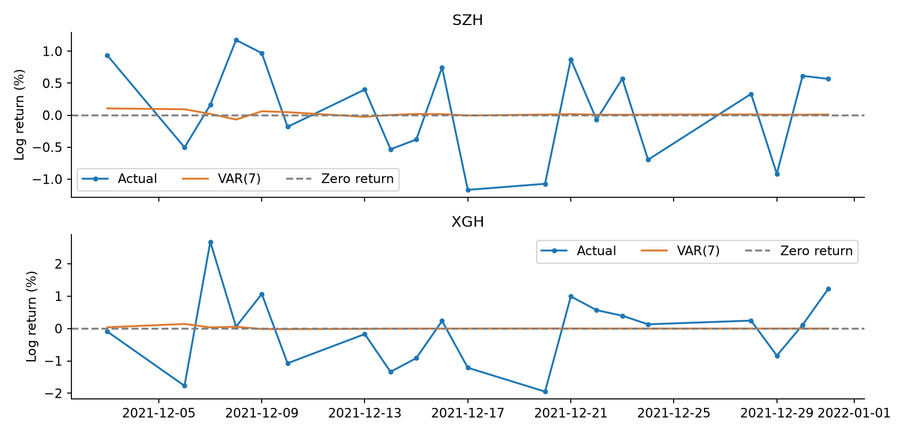

# Shanghai–Hong Kong Market Linkages

**VAR forecasting, Granger testing, and how much an "identified shock" really tells you**

`Python` · `statsmodels` · `VAR / VECM` · `Johansen` · `fully re-executed on every run`

---

## Headline

A bivariate VAR(7) on 2,578 training days of Shanghai and Hang Seng log returns
beats a zero-return benchmark on Shanghai RMSE by a hair, **loses on MAE in both
markets**, and shows no Granger causality in either direction at 5%.

The most informative result is a negative one. The headline number a careless
version of this project would report — "a Shanghai shock explains **32.4%** of
Hong Kong's 10-step forecast-error variance" — collapses to **0.35%** when the
Cholesky ordering is reversed. Same data, same model, same sample: only the
identifying assumption changed.

| Cholesky order | SZH shock → XGH variance, h=10 |
| --- | ---: |
| `[SZH, XGH]` | 32.43% |
| `[XGH, SZH]` | 0.35% |



That table is the project. Any variance decomposition quoted without its ordering
is an assumption dressed up as a finding.

## Research question

Do lagged Shanghai and Hong Kong index returns carry useful incremental
predictive information — and how much of any apparent "linkage" survives a change
of specification or identification?

Four questions are kept separate rather than used interchangeably as evidence of
causality: stationarity, out-of-sample prediction, Granger testing, and shock
identification.

## Data and research design

| Dataset | Rows | Start | End |
| --- | ---: | --- | --- |
| Prices | 2,599 | 2011-01-04 | 2021-12-31 |
| VAR training | 2,578 | 2011-01-05 | 2021-12-02 |
| VAR holdout | 20 | 2021-12-03 | 2021-12-31 |
| Cointegration levels | 1,461 | 2016-01-04 | 2021-12-31 |

Returns are `100 × Δln(price)`, so a value of 1 is a 1% log return and forecast
errors are in percentage points. Every lag selection, estimation, ADF, Granger,
IRF and FEVD calculation uses **training data only**. The 20-day holdout is
forecast once from the final seven training observations, with no refitting and
no realised values fed back in.

The second dataset (`XZSJ.csv`, a macro-financial cointegration exercise) is kept
strictly separate: its `SZH` column is **already logged** and is not logged again,
and it is never used to select the return VAR.

## Results

**Out-of-sample, 20 common trading days, percentage points:**

| Model | Series | RMSE | MAE |
| --- | --- | ---: | ---: |
| VAR(7) | SZH | 0.71984 | 0.64486 |
| Zero return | SZH | 0.72114 | 0.64353 |
| VAR(7) | XGH | 1.11109 | 0.85704 |
| Zero return | XGH | 1.10393 | 0.85339 |

VAR(7) wins on exactly one of four cells. Reporting only the Shanghai RMSE would
be cherry-picking.



**Granger tests (training only, VAR lag 7):**

| Direction | F | p | Reject at 5% |
| --- | ---: | ---: | --- |
| SZH → XGH | 1.2758 | 0.2579 | No |
| XGH → SZH | 1.9298 | 0.0609 | No |

Failure to reject is not proof of no linkage; it means these seven lags do not
jointly improve this conditional-mean equation. Trading-hour differences and
omitted global factors remain plausible explanations.

**Lag selection disagrees with itself:** AIC and FPE pick 7, BIC and HQIC pick 0.
Residual whiteness only appears from lag 6 onward (12-lag portmanteau *p* rises
from 1.5e-05 at lag 0 to 0.77 at lag 7), which is why VAR(7) is carried forward —
but a model chosen by one criterion out of four is reported as such.

**Cointegration:** Johansen selects rank 2 stably across `q = 1, 2, 3`, yet every
fitted VECM rejects residual whiteness, and the bivariate Engle–Granger test on
SZH/SHIBOR gives *p* = 0.618. The honest conclusion is that this exercise does
**not** establish a robust long-run equilibrium, and no VECM forecast is deployed
on the back of it.

## What I would do differently with more time

Pre-registered rolling-origin evaluation on more data, inference robust to the
heavy tails and conditional heteroskedasticity that financial residuals actually
have, structural-break tests before assuming constant parameters, and shock
identification justified by economics (trading hours, overnight information flow)
rather than by variable order in a list.

## Reproduce

```bash
pip install -r requirements.txt
python run_analysis.py
```

The runner verifies input hashes against `provenance.json`, re-executes the
notebook from cleared outputs, fails on any cell error, and compares every
regenerated number against `reference_results.json` at `rtol=1e-6`.

Keep the repository's root `portfolio_common/` directory alongside `projects/`;
the project entry point locates it without requiring `PYTHONPATH`. It can be
called from the project directory or by script path from another directory.
Before execution, exact package versions are checked against the read-only
`requirements.txt`. Missing packages or mismatches stop the run with a clear
error; actual versions and mismatches are recorded in `results/environment.json`,
including failed checks. The root-level `environment.json` is a historical
record and is not overwritten. `python run_analysis.py --check-only` checks
environment, input hashes, English source and source synchronization without
executing the notebook or certifying regenerated numbers.

`Research_Analysis.ipynb` is the canonical analysis. From the repository root,
use `python -B portfolio_common/notebook_source.py projects/02-shanghai-hongkong-market-linkages`
to regenerate `analysis.py`, or add `--check` to verify synchronization.
For edits made to the exported Python cells, `--update-notebook-code` explicitly
imports them into the notebook and clears stale outputs; it never executes the
analysis. The runner rejects an unsynchronized export.

Last verified run: **8 reference tables, 334 numeric values matched, 0 errors**
(see `results/verification.json`).

## Contents

- `Research_Analysis.ipynb` / `.html` — the executed analysis
- `REPORT.md` / `FIRST_READ.html` — the full written report, including the
  complete lag-diagnostic and FEVD-sensitivity tables
- `analysis.py` — the analysis as a plain module
- `results/` — regenerated tables and figures
- `VARSJ.csv`, `XZSJ.csv` — the two input datasets
- `source_materials/` — the original course notebook and datasets, unmodified

## Provenance and limitations

Developed from supplied econometrics coursework; original materials retained
unmodified in `source_materials/`. Vendor, collection process and exact
observation timestamps of the supplied data were not independently verified, and
the two markets' differing trading hours are a known limitation of same-day
return alignment. AI assistance was used for code completion, analytical
organisation, verification and English writing; the sensitivity analyses that
drive the conclusions, and all interpretation, are my own.
