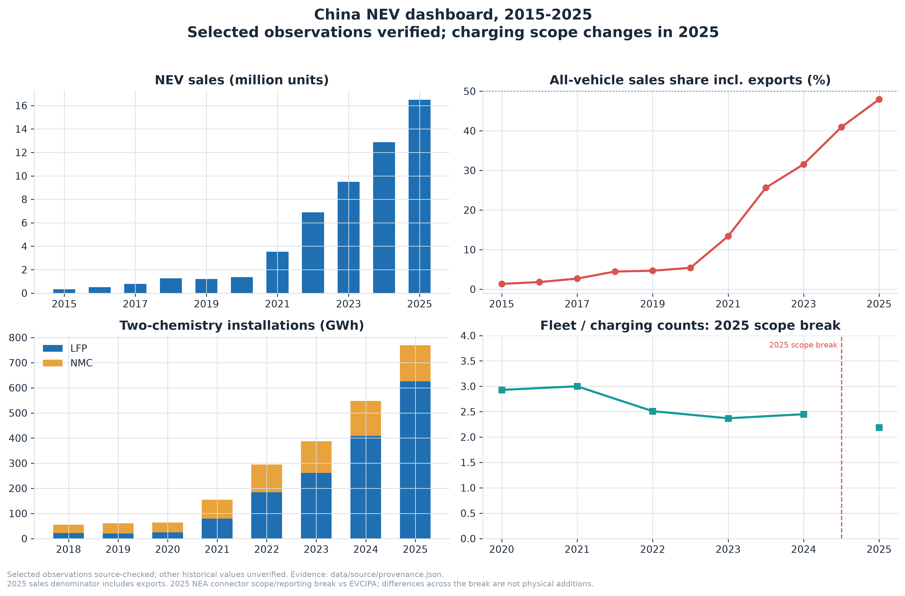
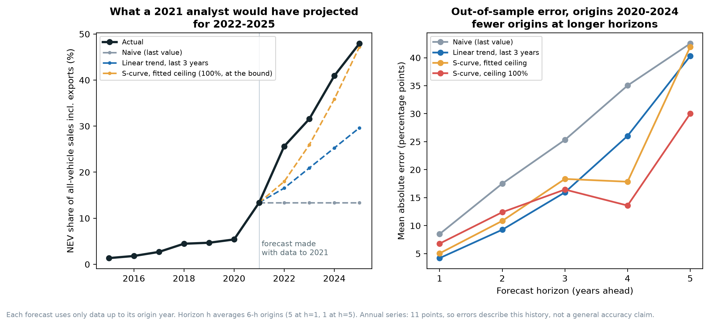
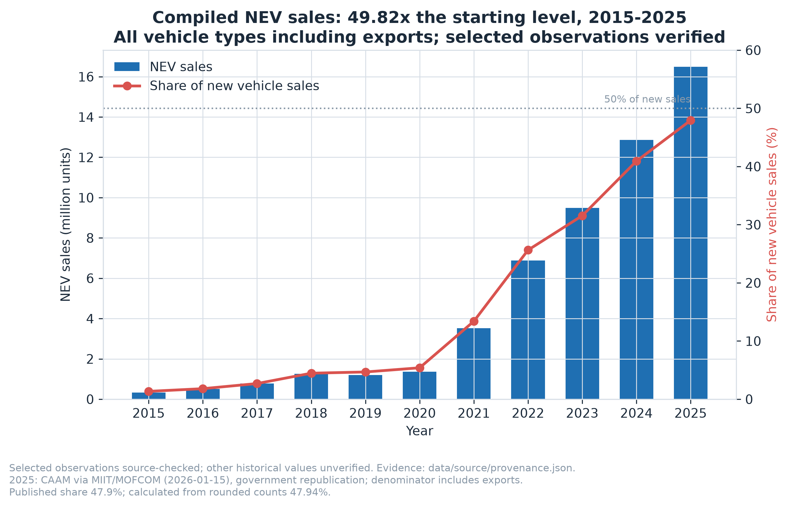
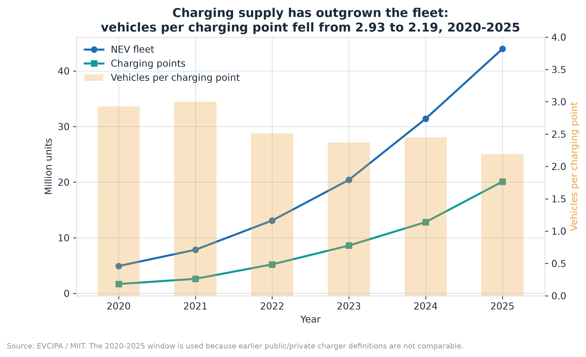
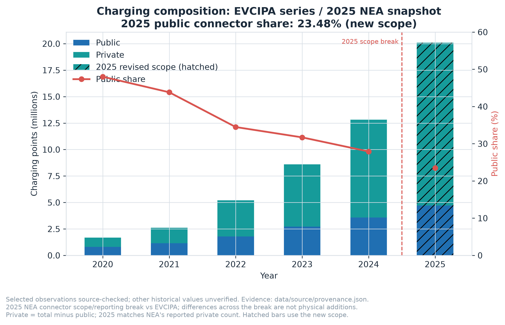
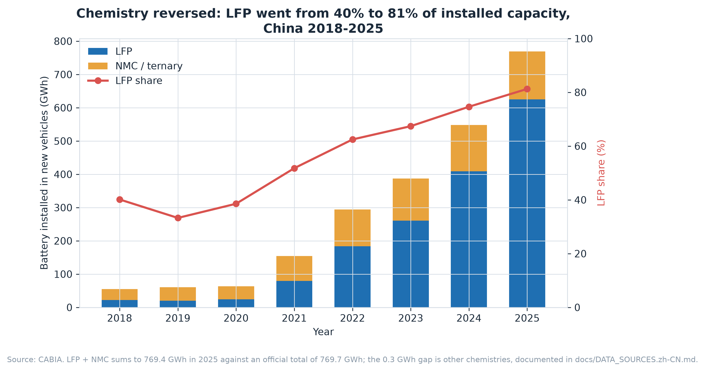
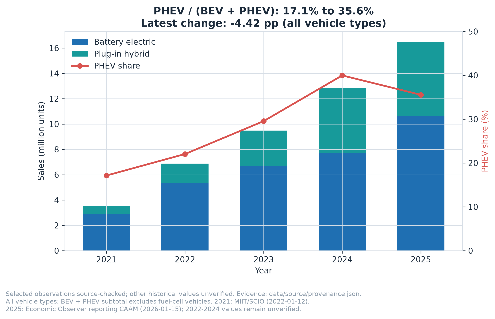
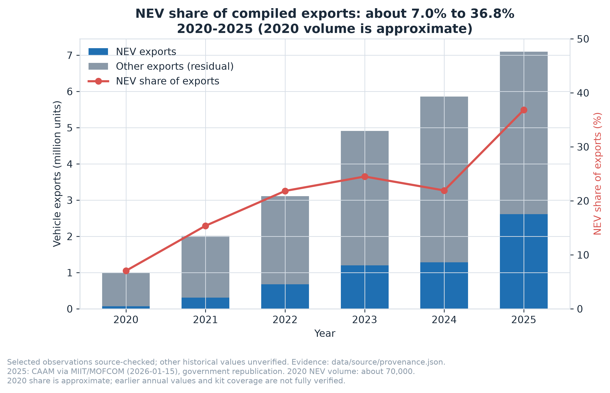
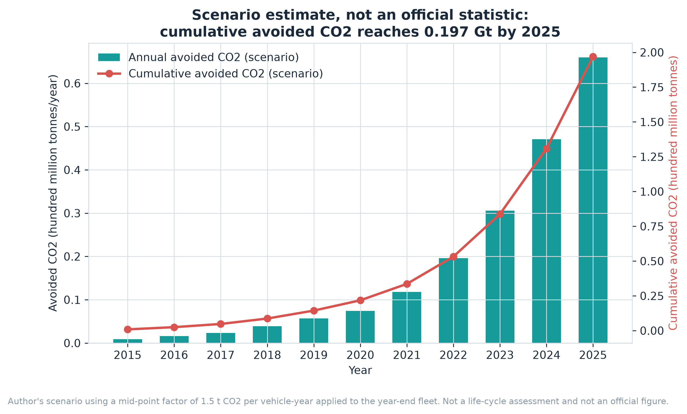

# China's New Energy Vehicle Transition, 2015–2025

**Author: 闫佳玉 / Jiayu Yan**

**Turning eleven years of public industry statistics into a reproducible, caveat-explicit analysis**

`Python` · `pandas` · `matplotlib` · `scipy` · `bilingual figure sets` · `7 tables, 16 figures` · `out-of-sample forecast backtest`

---

## Decision brief

**Question:** What do national statistics establish about the NEV transition,
how reliably could its pace have been forecast, and are the statistics
sufficient to support a charging-investment assessment?

**Data and method:** Seven compiled tables, explicit source and denominator
reconciliation, bilingual descriptive figures, and a rolling-origin backtest of
the market-sizing models an analyst would typically use. No investment-return
model is built.

**Finding and implication:** NEVs reach 47.9% of 2025 all-vehicle sales including
exports (50.8% on a domestic basis). Every trend model **under-forecast** the
transition out of sample, and the S-curve ceiling, the assumption that decides
a market-size estimate, moved from 6% to 100% to 54% as data arrived. Sizing
should be presented as ceiling scenarios and updated yearly, not as one curve.
The charging-series break prevents a continuous cross-break comparison.

**Next evidence needed:** Local demand, connector power, utilization, electricity
and site costs would be needed before evaluating capacity or returns. No investment
was implemented, and no ROI or measured emissions reduction is claimed.

## Headline

Between 2015 and 2025 China's NEV sales grew roughly **50×**, from 0.33 to 16.49
million units, and NEV share of all-vehicle sales including exports went from
**1.3% to 47.9%**.
The more interesting findings are the ones that run against the simple story:

- **Charging counts have a 2025 statistical break.** EVCIPA historical counts and
  NEA's 2025 connector snapshot use different reporting scopes. Cross-break ratios
  cannot establish continuous growth or public-charging accessibility.
- **Battery chemistry reversed.** LFP went from 40% of installed capacity in 2018
  to **81%** in 2025 within the LFP + ternary subtotal.
- **Powertrain shares vary over time.** PHEV share of the BEV + PHEV subtotal
  rose from 17% in 2021 to **36%** in 2025, but fell **4.42 percentage points**
  in the latest year. This covers all vehicle types, excluding fuel-cell vehicles.
- **Export mix changed.** NEVs went from approximately 7% in 2020 to **37%**
  of China's vehicle exports in 2025.



## Could the pace have been forecast? An out-of-sample backtest

A market-sizing deck usually extrapolates a trend. `src/market_backtest.py`
tests how well that would have worked here. At each origin year 2020–2024, a
model sees 2015 up to the origin only and forecasts every later year to 2025:
15 genuine out-of-sample forecasts per model.

| Model | MAE, all horizons (pp) | MAE, 1 year ahead (pp) | Mean error (pp) | 2025 forecast made in 2021 |
| --- | ---: | ---: | ---: | ---: |
| Naive (last value) | 20.1 | 8.5 | −20.1 | 13.4% |
| Linear trend, last 3 years | 13.2 | **4.2** | −10.7 | 29.6% |
| S-curve, fitted ceiling | 13.4 | 5.1 | −7.0 | 47.2% |
| S-curve, ceiling fixed at 50% | **10.5** | 4.3 | −10.0 | 34.8% |
| S-curve, ceiling fixed at 70% | 11.1 | 5.1 | −6.3 | 41.0% |
| S-curve, ceiling fixed at 100% | 12.7 | 6.8 | −3.1 | 47.2% |

Actual 2025 share: **47.9%**. Three findings matter for a sizing decision:

- **Every model under-forecast on average.** Mean errors are all negative;
  the transition ran ahead of every extrapolation tried.
- **The ceiling is not identified until after the inflection.** The fitted
  S-curve ceiling was **6%** at the 2020 origin, hit the **100%** bound at 2021
  and 2022, then fell to **52%** and **54%** at 2023 and 2024. The 2021 S-curve's
  near-exact 2025 forecast came from a ceiling stuck at its bound, not from the
  data pinning it down.
- **The best rule depends on the horizon.** A three-year linear trend is the
  most accurate one year ahead (4.2 pp); fixed-ceiling S-curves do better over
  longer horizons. With five origins and one five-year forecast, these errors
  describe this history, not a general accuracy claim.

The denominator also moves the answer. On a domestic basis (sales minus
exports, using the export table) the 2025 share is **50.8%**, not 47.9%; the gap
was **4.4 pp** in 2024. Domestic charging demand should be sized on the
domestic basis.



**Implication:** present NEV market size as scenarios under stated ceilings,
re-fitted each year, with the domestic and export bases kept separate. A single
fitted curve would have given a 2020 analyst a 6% ceiling.

## Why this project exists

Macro industry narratives are easy to assert and hard to check. The aim here was
to take a familiar claim — "China electrified its car market" — and rebuild it
from published statistics in a way a reader can audit line by line: which series,
which definition, which denominator, and which numbers are *mine* rather than
official.

## The analytical discipline

| Issue | How it is handled |
| --- | --- |
| Sales shares use different denominators | The 2025 47.9% uses CAAM **all-vehicle sales including exports**, not domestic sales or registrations |
| Charging has a 2025 statistical break | Figures separate the 2025 NEA snapshot from 2020–2024 EVCIPA counts |
| Battery subtotals differ from the full market | Shares use LFP + ternary; the residual is unallocated, not verified as other chemistries |
| Carbon impact is not an official statistic | 1.5 t CO₂ per vehicle-year is an author-selected assumption, not measured avoided emissions or a life-cycle assessment |
| Export figures vary by basis | Historical scope and kit coverage are not fully verified; rounded inputs remain labelled |

The [source audit](../../docs/NEV_SOURCE_AUDIT.md) records corrections and unresolved
definitions. Field-level provenance contains 21 `verified_external`, 93
`compiled_from_coursework`, 2 `needs_verification` observations and 1 `assumption`.
Headline endpoint comparisons describe the compilation, not a fully verified series.

Every derived indicator — new-vehicle penetration, vehicles per charger,
chemistry share, PHEV share, export share — is computed in code from the source
tables, not copied from a press release.

## Figures

English set (`charts_en/`, built by `src/build_figures_en.py`):

| | |
| --- | --- |
|  |  |
|  |  |
|  |  |

The scenario estimate is kept visually separate because it combines fleet counts
with an assumed emissions factor:



A Chinese figure set (`charts/`, built by `src/nev_visualization.py`) is included.
Chinese/English slide decks (`presentation/`) are historical course deliverables;
their embedded figures and narrative are not the current findings.

## Reproduce

```bash
pip install -c ../../constraints.txt -r requirements.txt
python src/nev_visualization.py   # writes data/*.csv and the Chinese charts/
python src/build_figures_en.py    # rebuilds tables and writes charts_en/
python src/market_backtest.py     # writes results/: backtest, ceilings, denominators
python src/data_pipeline.py --check-outputs --check-figures
python -m unittest discover -s tests -v
```

No network access is required. Both renderers use `src/data_pipeline.py` and
validated inputs from `data/source/` to regenerate the seven derived CSVs.
The backtest tests confirm that changing any value after an origin leaves that
origin's forecasts unchanged.
Strict source verification (`python src/data_pipeline.py --require-verified`)
intentionally fails while unresolved source records remain.

## Contents

- `data/` — the seven compiled tables (CSV, Chinese column names)
- `results/` — backtest forecasts and errors, fitted ceilings, denominator table, figure
- `charts_en/` — English figure set, 300 dpi
- `charts/` — Chinese figure set, 300 dpi
- `src/build_figures_en.py` — English renderer
- `src/nev_visualization.py` — Chinese renderer
- `src/market_backtest.py` — rolling-origin forecast backtest
- `src/data_pipeline.py` — shared validation and derived indicators
- `data/source/` — source observations, assumptions and field-level provenance
- `docs/DATA_SOURCES.zh-CN.md` — compiled tables and candidate citations; see the source audit for verification status
- `docs/STORY.md`, `docs/PROJECT_PROFILE.zh-CN.md` — narrative framing
- `presentation/` — historical bilingual decks

## Provenance and limitations

The compilation draws on industry statistics with verification status recorded
per observation. This analysis contains no causal estimate of policy
effects; the carbon figure is a scenario rather than a measurement. The backtest
uses the compiled series as published, including its unverified records.
Author: 闫佳玉 / Jiayu Yan. AI tools were used for coding support and English editing; the author reviewed and verified all code, results and conclusions. Original materials are retained for comparison.
