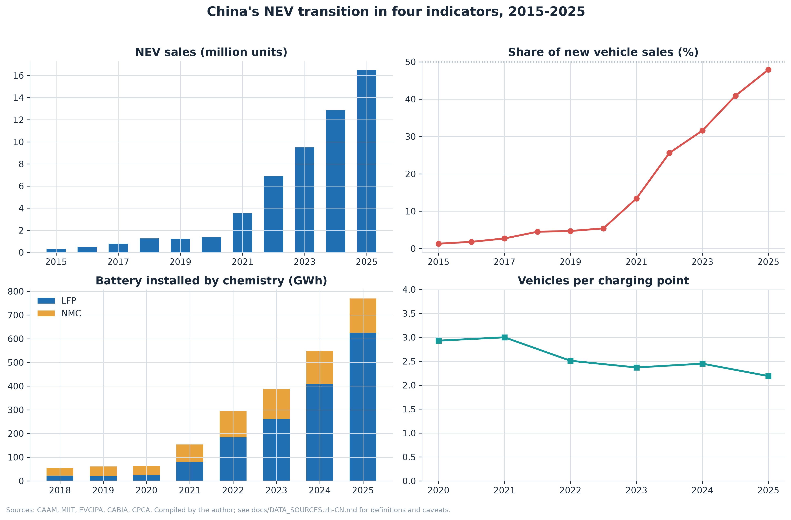
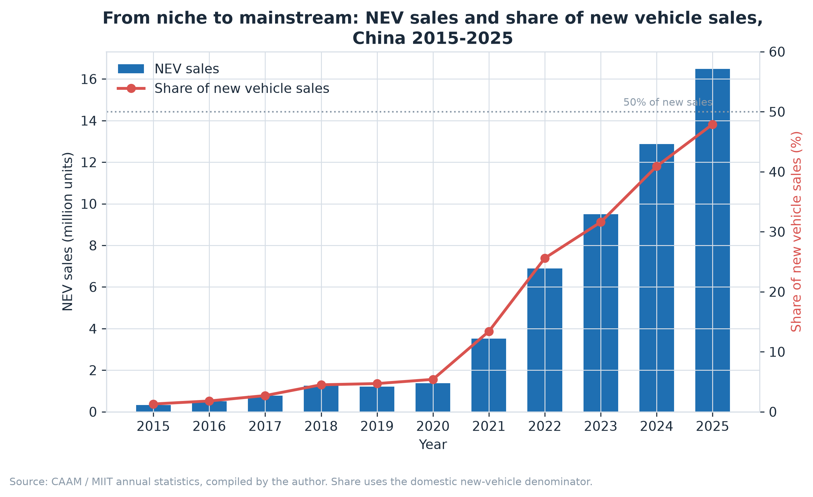
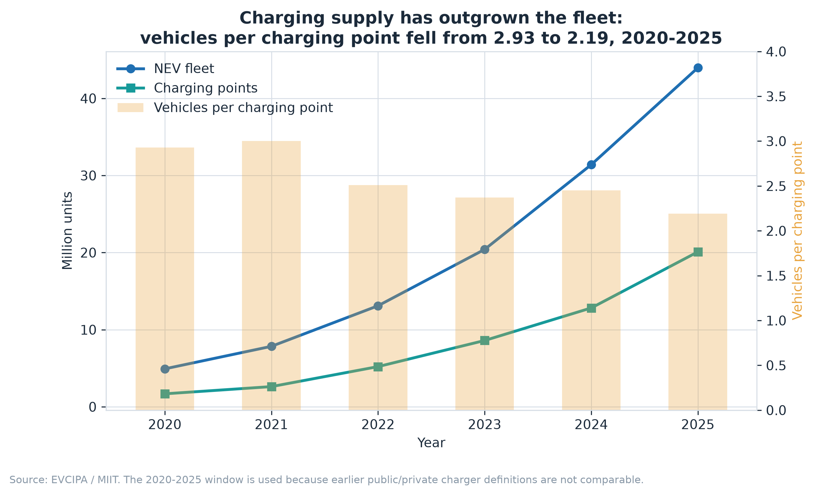
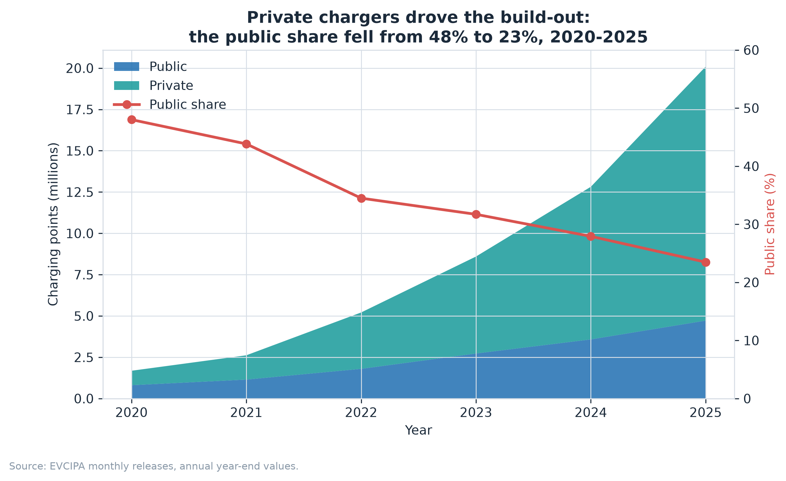
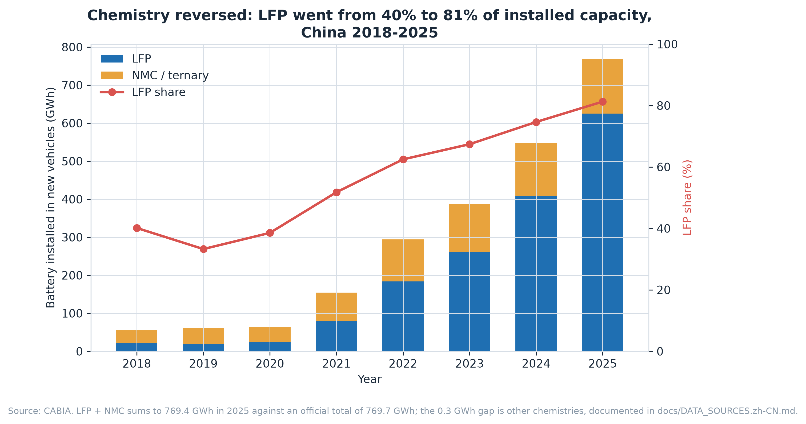
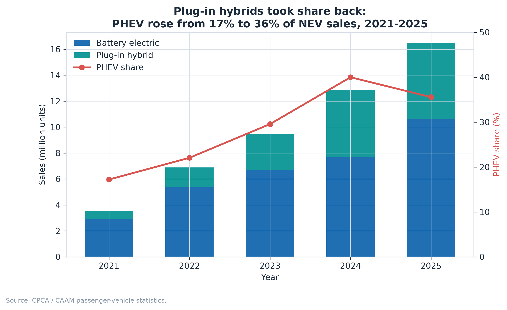
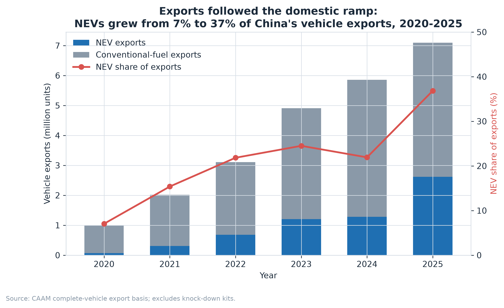
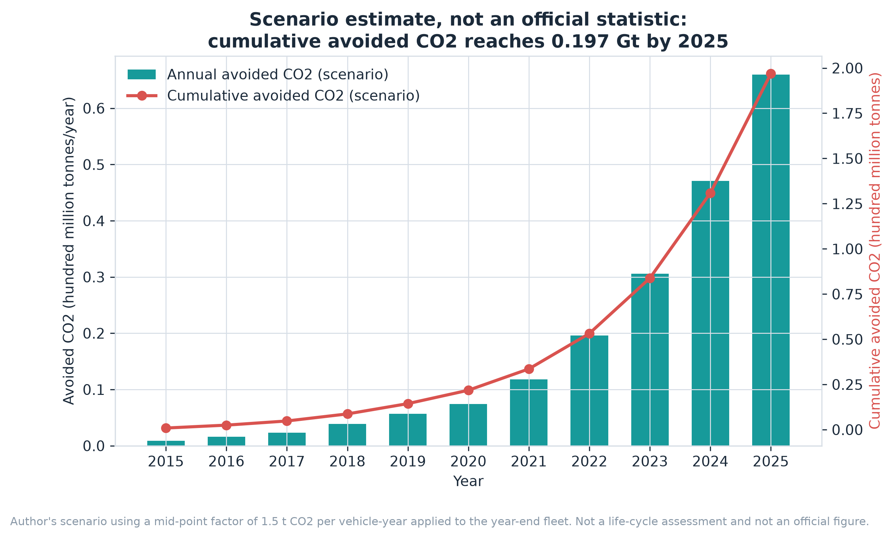

# China's New Energy Vehicle Transition, 2015–2025

**Turning eleven years of public industry statistics into a reproducible, caveat-explicit analysis**

`Python` · `pandas` · `matplotlib` · `bilingual figure sets` · `7 tables, 16 figures`

---

## Headline

Between 2015 and 2025 China's NEV sales grew roughly **50×**, from 0.33 to 16.49
million units, and NEV share of new vehicle sales went from **1.3% to 47.9%**.
The more interesting findings are the ones that run against the simple story:

- **Charging supply outgrew the fleet.** Vehicles per charging point *fell* from
  2.93 to 2.19 — but almost entirely through **private** chargers. The public
  share of charging points dropped from 48% to 23%, which means the per-charger
  ratio is a weak proxy for how easy public charging actually is.
- **Battery chemistry reversed.** LFP went from 40% of installed capacity in 2018
  to **81%** in 2025, displacing nickel-rich ternary cells.
- **Plug-in hybrids took share back.** PHEVs rose from 17% to **36%** of NEV
  sales, so "electrification" is not a one-way march to battery-electric.
- **Exports followed with a lag.** NEVs went from 7% to **37%** of China's vehicle
  exports.



## Why this project exists

Macro industry narratives are easy to assert and hard to check. The aim here was
to take a familiar claim — "China electrified its car market" — and rebuild it
from published statistics in a way a reader can audit line by line: which series,
which definition, which denominator, and which numbers are *mine* rather than
official.

## The analytical discipline

| Issue | How it is handled |
| --- | --- |
| Three different "penetration rates" circulate | Only the **domestic new-vehicle** denominator is used, and it is labelled on every figure |
| Charger definitions changed before 2020 | The charging series starts at 2020 rather than silently splicing incomparable years |
| 2025 LFP + NMC = 769.4 GWh vs official total 769.7 GWh | The 0.3 GWh gap is documented as other chemistries, not quietly rounded away |
| Carbon impact is not an official statistic | Reported as an explicit scenario (1.5 t CO₂ per vehicle-year, mid-point factor), captioned as *not* a life-cycle assessment |
| Export figures vary by basis | CAAM complete-vehicle basis, knock-down kits excluded, stated on the figure |

Every derived indicator — new-vehicle penetration, vehicles per charger,
chemistry share, PHEV share, export share — is computed in code from the source
tables, not copied from a press release.

## Figures

English set (`charts_en/`, built by `src/build_figures_en.py`):

| | |
| --- | --- |
|  |  |
|  |  |
|  |  |

The scenario estimate is kept visually separate because it is the one figure that
is not built from published statistics:



A Chinese figure set (`charts/`, built by `src/nev_visualization.py`) and
Chinese/English slide decks (`presentation/`) are included for audiences that
need them.

## Reproduce

```bash
pip install -r requirements.txt
python src/nev_visualization.py   # writes data/*.csv and the Chinese charts/
python src/build_figures_en.py    # reads data/*.csv, writes charts_en/
```

No network access is required. `nev_visualization.py` holds the compiled source
statistics and regenerates all seven CSVs; `build_figures_en.py` is a pure
presentation layer over those CSVs and performs no estimation of its own.

## Contents

- `data/` — the seven compiled tables (CSV, Chinese column names)
- `charts_en/` — English figure set, 300 dpi
- `charts/` — Chinese figure set, 300 dpi
- `src/build_figures_en.py` — English renderer
- `src/nev_visualization.py` — source statistics, derived indicators, Chinese renderer
- `docs/DATA_SOURCES.zh-CN.md` — **the audit trail**: every series, its publisher,
  its definition, and where my figures differ from official totals
- `docs/STORY.md`, `docs/PROJECT_PROFILE.zh-CN.md` — narrative framing
- `presentation/` — bilingual decks

## Provenance and limitations

Sources are CAAM, MIIT, EVCIPA, CABIA and CPCA annual and monthly releases,
compiled by hand into the seven tables in `data/`; the compilation and all
derived indicators are mine. This is a descriptive analysis of published
aggregates: it contains no causal estimate of policy effect, and the carbon
figure is a trend scenario rather than a measurement. Developed from a course
design project; AI assistance was used for code structuring, English writing and
verification.
