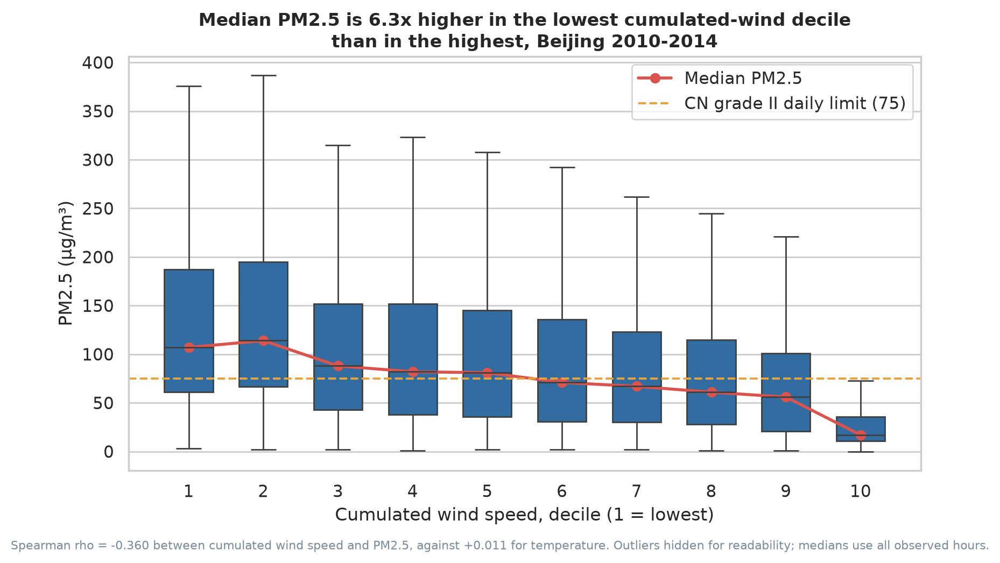
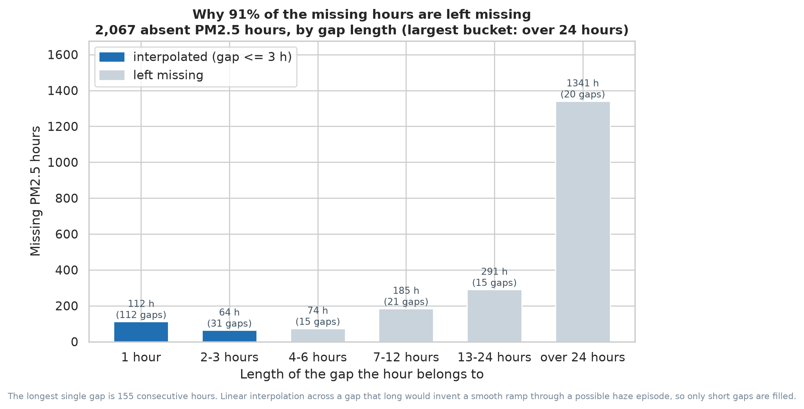
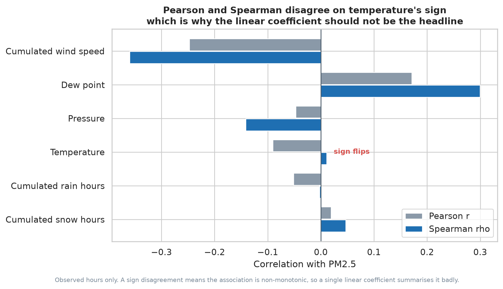
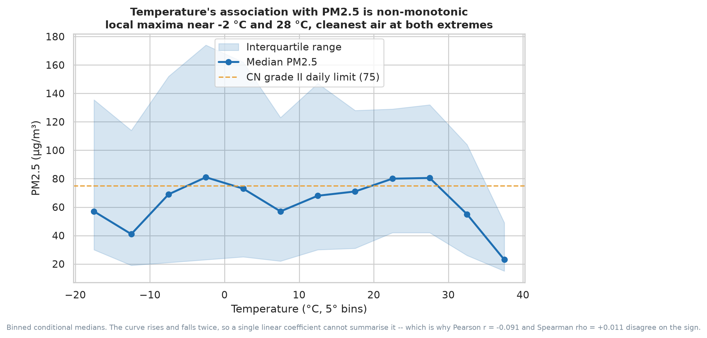
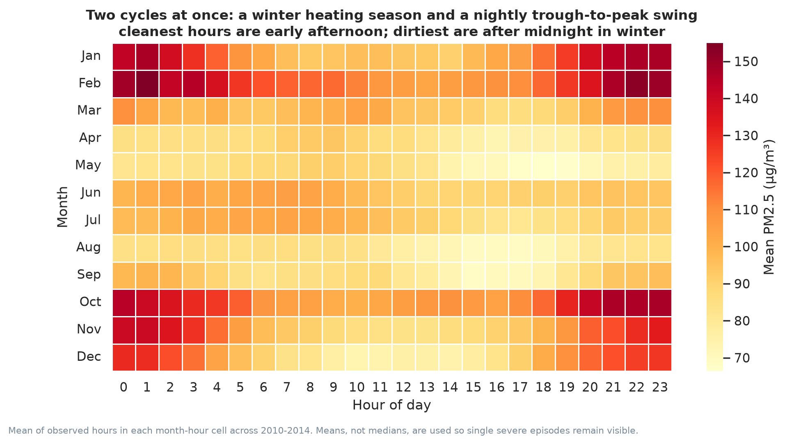

# Beijing PM2.5, 2010–2014

**Author: 闫佳玉 / Jiayu Yan. Original coursework independently completed by the author.**

**Observed-hour associations and an explicit audit of missing-data policy**

`Python` · `Seaborn` · `43,824 hourly observations` · `7 figures`

---

## Headline

Across five years, **48.5% of observed hourly readings** were above 75 µg/m³
and **7.3%** were above 250 µg/m³. These are hourly comparisons with reference
values used for daily air-quality assessment, **not daily compliance rates**.

Cumulated wind speed has a stronger marginal rank association with PM2.5
than temperature in this sample:

| Driver | Spearman ρ with PM2.5 |
| --- | ---: |
| **Cumulated wind speed** | **−0.360** |
| Dew point | +0.300 |
| Pressure | −0.142 |
| Temperature | **+0.011** |

Median PM2.5 in the lowest cumulated-wind-speed decile is **107 µg/m³**
against **17 µg/m³** in the highest — a **6.3×** difference.
The source's `Iws` field measures cumulated wind speed, not instantaneous wind.
By wind direction, northwesterlies run a
median of **31 µg/m³** against **98** in calm or variable hours.



## Two decisions that changed the conclusions

### 1 · Most of the missing data should not be imputed

2,067 PM2.5 hours are absent, spread over 214 gaps. The median gap is one hour —
but the longest is **155 consecutive hours**, and **1,341 hours sit inside gaps
longer than a day**. Linear interpolation across a six-day gap draws a smooth
ramp through what may have been an entire haze episode, then feeds that invented
shape into every correlation downstream.

The policy audit constructs a separate series filling gaps of **≤3 hours**
(176 hours, 0.4% of the series) and leaving **1,891 hours missing**.
That candidate series is **not used in the headline analysis**: every pollution
distribution, correlation and conditional summary uses the original observed
values, excluding all **2,067 missing hours** (41,757 observed hours).
The gap figure evaluates what a limited imputation policy would permit.



### 2 · The temperature finding was an artefact of the statistic

Temperature gives Pearson *r* = **−0.091** but Spearman ρ = **+0.011**.
Both are small. Their different signs motivate examining the conditional
shape; a sign disagreement alone does not establish non-monotonicity.

Binning temperature and plotting conditional medians shows why: PM2.5 rises and
falls twice across the temperature range, with local maxima near 0 °C and near
25 °C and the cleanest air at both extremes. That is a shape no single
coefficient can carry.





## Structure in time

Two cycles run at once — a winter heating season and a daily swing that bottoms
out in early afternoon and peaks after midnight. February and October are the
worst months; mid-afternoon is the cleanest hour in every month.



## What this analysis does not claim

These are associations in observational data from a single monitoring station.
Wind clearing pollution is physically plausible, but the dataset cannot separate
transport from local emission, and `cbwd` is a source-defined combined category
rather than a measured bearing. `Ir` and `Is` count **cumulated hours** of rain
and snow, not millimetres, so they are not precipitation intensity. The 75 and
250 µg/m³ lines are *daily* standards drawn on hourly data for orientation only.
Serial dependence, seasonality, station coverage and unmeasured emissions
prevent these marginal correlations from identifying an intervention effect.

## Decision relevance

For an operations team planning outdoor shifts, use low-ventilation periods
as a candidate risk indicator alongside live local monitoring and official
forecasts. These historical associations justify evaluating a warning rule;
they do not by themselves justify production restrictions or schedule changes.
Before deployment, validate on later time periods and additional stations,
measure missed high-pollution events and false alarms, and assess the cost
of each. Daily regulatory compliance requires daily aggregation and the
applicable data-completeness rules.

## Reproduce

```bash
python -m pip install -c ../../constraints.txt -r requirements.txt
python src/analyze.py
```

Writes `figures/*.png`, the tables in `outputs/`, and `outputs/findings.json`.
The report's figures can be checked against those outputs; this README is
maintained separately and is not generated automatically.
The script asserts the input is a gap-free hourly index before
measuring gap lengths, because gap statistics on an irregular index would be
meaningless.

## Contents

- `src/analyze.py` — the whole pipeline, documented
- `figures/` — seven figures, 200 dpi
- `outputs/` — gap audit, correlations, wind deciles, temperature bins,
  month × hour means, plus `findings.json`
- `data/` — the source CSV, unmodified
- `source_materials/` — the original coursework script and the assignment brief

## Provenance

Data: [Beijing PM2.5 Dataset](https://archive.ics.uci.edu/dataset/381/beijing+pm2+5+data)
(Liang et al., 2015), UCI Machine Learning Repository — US Embassy Beijing PM2.5
readings paired with Beijing Capital International Airport meteorology,
2010-01-01 to 2014-12-31, used unmodified.

Developed from a course Seaborn assignment; the original script is kept in
`source_materials/` for comparison. AI participated in the gap-audit design,
statistical framing, code, interpretation and writing. Current methodological
additions are portfolio extensions, not claimed as independently designed
original coursework. Opposite Pearson/Spearman signs alone do not establish
non-monotonicity; binned summaries are descriptive and subject to confounding.
