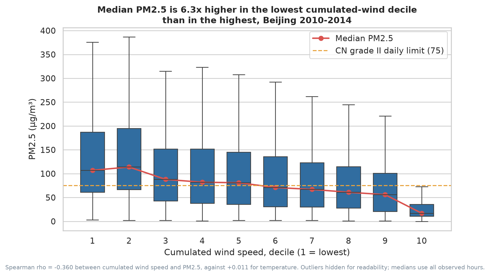
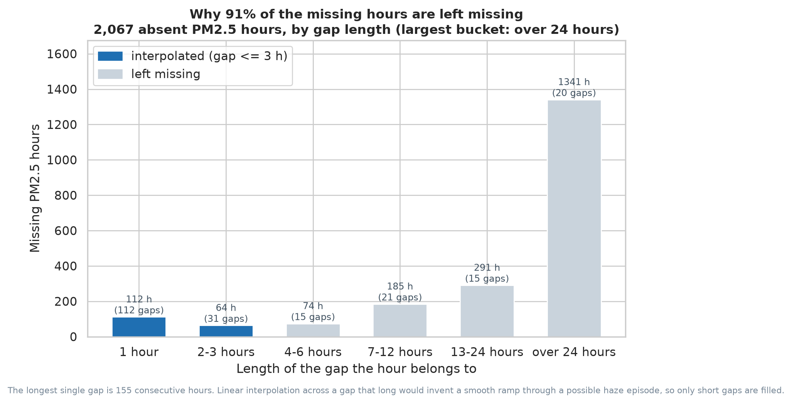
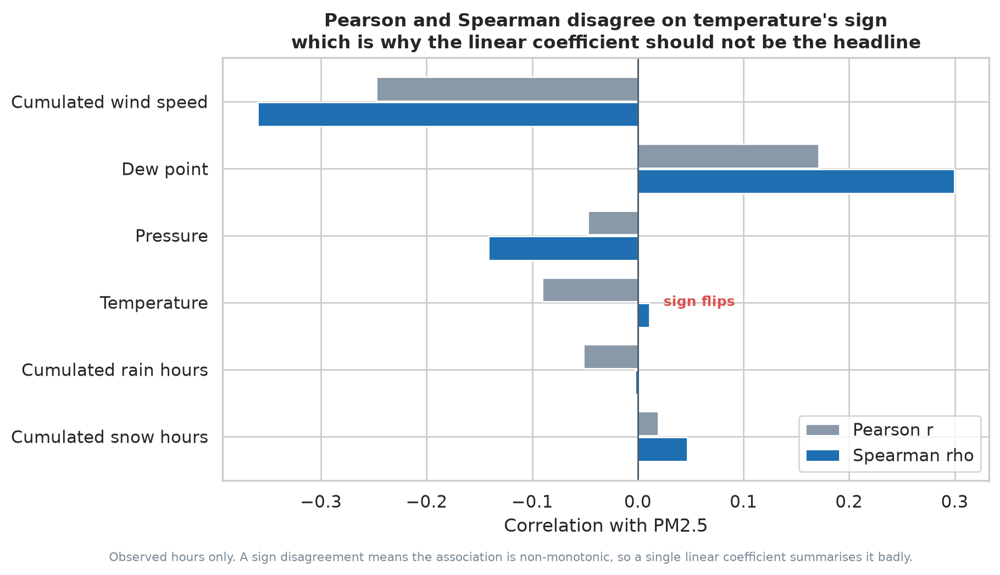
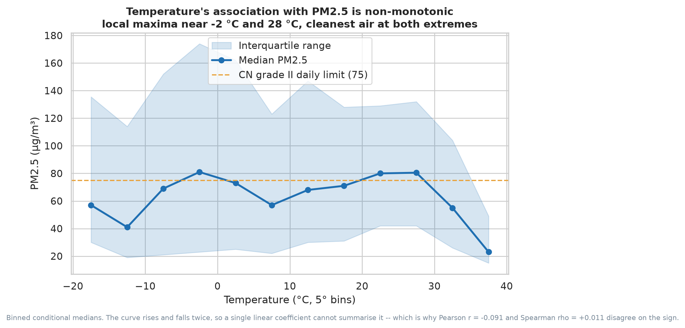
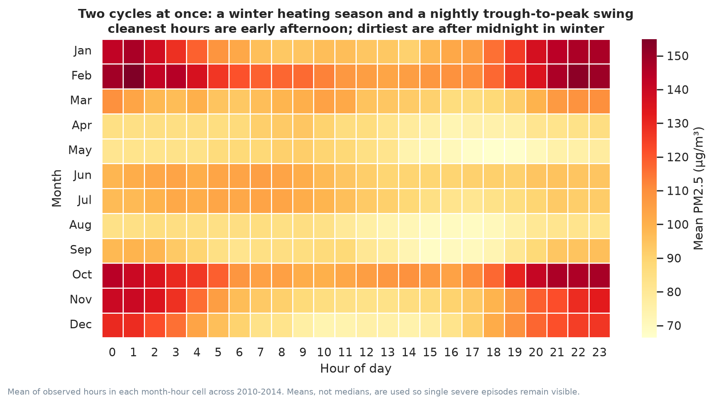
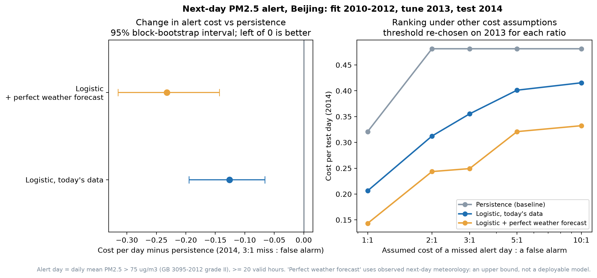

# Beijing PM2.5, 2010–2014

**Author: 闫佳玉 / Jiayu Yan**

**Observed-hour associations, an explicit audit of missing-data policy, and an out-of-sample next-day alert test**

`Python` · `Seaborn` · `statsmodels` · `43,824 hourly observations` · `8 figures`

---

## Headline

Across five years, **48.5% of observed hourly readings** were above 75 µg/m³
and **7.3%** were above 250 µg/m³. These are hourly comparisons with reference
values used for daily air-quality assessment, **not daily compliance rates**.

Cumulated wind speed has a stronger marginal rank association with PM2.5
than temperature in this sample:

| Driver | Spearman ρ with PM2.5 |
| --- | ---: |
| **Cumulated wind speed** | **−0.360** |
| Dew point | +0.300 |
| Pressure | −0.142 |
| Temperature | **+0.011** |

Median PM2.5 in the lowest cumulated-wind-speed decile is **107 µg/m³**
against **17 µg/m³** in the highest — a **6.3×** difference.
The source's `Iws` field measures cumulated wind speed, not instantaneous wind.
By wind direction, northwesterlies run a
median of **31 µg/m³** against **98** in calm or variable hours.



## Two decisions that changed the conclusions

### 1 · Most of the missing data should not be imputed

2,067 PM2.5 hours are absent, spread over 214 gaps. The median gap is one hour —
but the longest is **155 consecutive hours**, and **1,341 hours sit inside gaps
longer than a day**. Linear interpolation across a six-day gap draws a smooth
ramp through what may have been an entire haze episode, then feeds that invented
shape into every correlation downstream.

The policy audit constructs a separate series filling gaps of **≤3 hours**
(176 hours, 0.4% of the series) and leaving **1,891 hours missing**.
That candidate series is **not used in the headline analysis**: every pollution
distribution, correlation and conditional summary uses the original observed
values, excluding all **2,067 missing hours** (41,757 observed hours).
The gap figure evaluates what a limited imputation policy would permit.



### 2 · The temperature finding was an artefact of the statistic

Temperature gives Pearson *r* = **−0.091** but Spearman ρ = **+0.011**.
Both are small. Their different signs motivate examining the conditional
shape; a sign disagreement alone does not establish non-monotonicity.

Binning temperature and plotting conditional medians shows why: PM2.5 rises and
falls twice across the temperature range, with local maxima near 0 °C and near
25 °C and the cleanest air at both extremes. That is a shape no single
coefficient can carry.





## Structure in time

Two cycles run at once — a winter heating season and a daily swing that bottoms
out in early afternoon and peaks after midnight. February and October are the
worst months; mid-afternoon is the cleanest hour in every month.



## From association to a decision: a next-day alert

The associations above suggest a decision rule, so the question becomes testable:
at the end of day *d*, should an operations team issue an alert for day *d*+1?
An **alert day** has a daily mean above 75 µg/m³, the GB 3095-2012 grade II
*daily* limit, applied here on the time scale it defines. Daily means need at
least 20 valid hours; nothing is interpolated.

- **Strict temporal split:** fit on 2010–2012, choose the alert threshold on
  2013, evaluate once on 2014 (349 test days, 181 alert days).
- **Baseline:** two-state persistence, P(alert tomorrow | alert today), fitted
  on the training years.
- **Model:** logistic regression on day-*d* observations only (PM2.5 level and
  evening trend, cumulated wind, dew point, pressure change, temperature, wind
  category, season).
- **Decision cost:** a missed alert day is assumed to cost 3× a false alarm;
  the threshold is chosen on 2013 to minimize that cost.
- **Uncertainty:** paired moving-block bootstrap over test days (7-day blocks,
  2,000 resamples).

| 2014 test year | AUC | Brier | Alert days caught | False alarms | Cost / day vs persistence (95% CI) |
| --- | ---: | ---: | ---: | ---: | --- |
| Persistence (baseline) | 0.679 | 0.218 | 181 / 181 | 168 | — |
| **Logistic, today's data** | **0.878** | **0.150** | 174 / 181 | **103** | **−0.126 [−0.195, −0.066]** |
| Logistic + perfect weather forecast | 0.934 | 0.108 | 168 / 181 | 48 | −0.232 [−0.315, −0.143] |

At the assumed 3:1 cost, the cost-optimal persistence rule degenerates to
*alert every day*: it catches every alert day but raises 168 false alarms.
The model keeps 96% of the catches and removes 65 of those false alarms.
Its advantage holds for every assumed cost ratio from 1:1 to 10:1, with the
threshold re-chosen on 2013 each time.

The third row adds the **observed** next-day meteorology. The dataset has no
archived weather forecasts, so this is an upper bound on what a forecast could
add, not a deployable model. The gap between rows two and three (55 fewer false
alarms) is the case for buying or integrating a weather-forecast feed.



## What this analysis does not claim

These are associations in observational data from a single monitoring station.
Wind clearing pollution is physically plausible, but the dataset cannot separate
transport from local emission, and `cbwd` is a source-defined combined category
rather than a measured bearing. `Ir` and `Is` count **cumulated hours** of rain
and snow, not millimetres, so they are not precipitation intensity. The 75 and
250 µg/m³ lines are *daily* standards drawn on hourly data for orientation only.
Serial dependence, seasonality, station coverage and unmeasured emissions
prevent these marginal correlations from identifying an intervention effect.

## Decision relevance

For an operations team planning outdoor shifts, the 2014 test supports
piloting the day-*d* alert model in place of a persistence rule: it cut alert
cost per day by 0.126 (95% CI 0.066–0.195) at the assumed cost ratio.
It does not justify production restrictions or emissions interventions.
Before deployment, confirm the cost ratio with the team that bears it, re-test
on later years and other stations, and add a real weather-forecast feed, whose
potential value the upper-bound row estimates. Daily regulatory compliance
requires the applicable completeness rules for official reporting.

## Reproduce

```bash
python -m pip install -c ../../constraints.txt -r requirements.txt
python src/analyze.py
python src/alert_model.py
python -m unittest discover -s tests -v
```

`analyze.py` writes figures 01–07, the tables in `outputs/`, and
`outputs/findings.json`. `alert_model.py` writes figure 08,
`outputs/07_alert_metrics.csv`, one prediction per test day in
`outputs/08_alert_test_predictions.csv`, and `outputs/alert_findings.json`.
The tests check that every target is the next calendar day, that no
same-day feature uses day *d*+1, and that the daily-mean validity rule holds.
The report's figures can be checked against those outputs; this README is
maintained separately and is not generated automatically.
The script asserts the input is a gap-free hourly index before
measuring gap lengths, because gap statistics on an irregular index would be
meaningless.

## Contents

- `src/analyze.py` — associations and the missing-data audit, documented
- `src/alert_model.py` — the next-day alert test, documented
- `tests/` — temporal-integrity checks for the alert model
- `figures/` — eight figures, 200 dpi
- `outputs/` — gap audit, correlations, wind deciles, temperature bins,
  month × hour means, alert metrics and test predictions, plus
  `findings.json` and `alert_findings.json`
- `data/` — the source CSV, unmodified
- `source_materials/` — the original coursework script and the assignment brief

## Provenance

Data: [Beijing PM2.5 Dataset](https://archive.ics.uci.edu/dataset/381/beijing+pm2+5+data)
(Liang et al., 2015), UCI Machine Learning Repository — US Embassy Beijing PM2.5
readings paired with Beijing Capital International Airport meteorology,
2010-01-01 to 2014-12-31, used unmodified.

Developed from a course Seaborn assignment; the original script is kept in
`source_materials/` for comparison. AI tools were used for coding support and English editing; the author reviewed and verified all code, results and conclusions. Opposite Pearson/Spearman signs alone do not establish
non-monotonicity; binned summaries are descriptive and subject to confounding.
