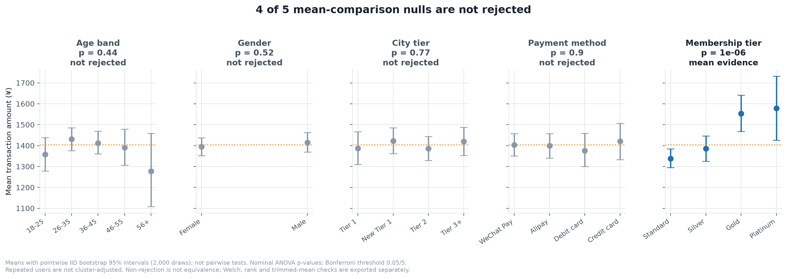
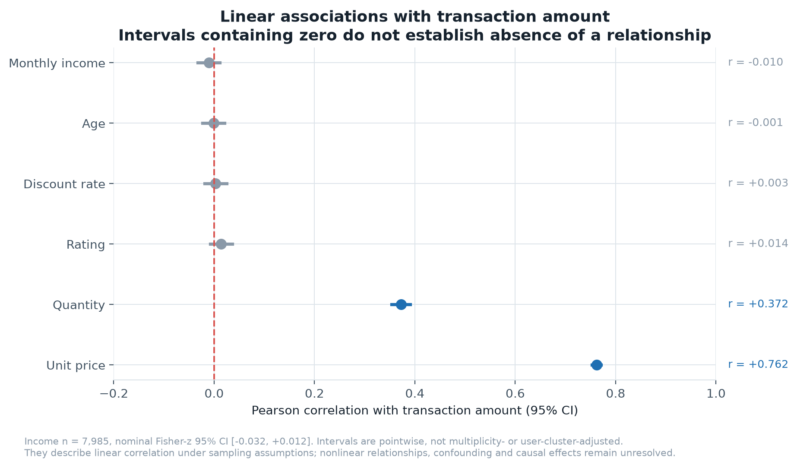
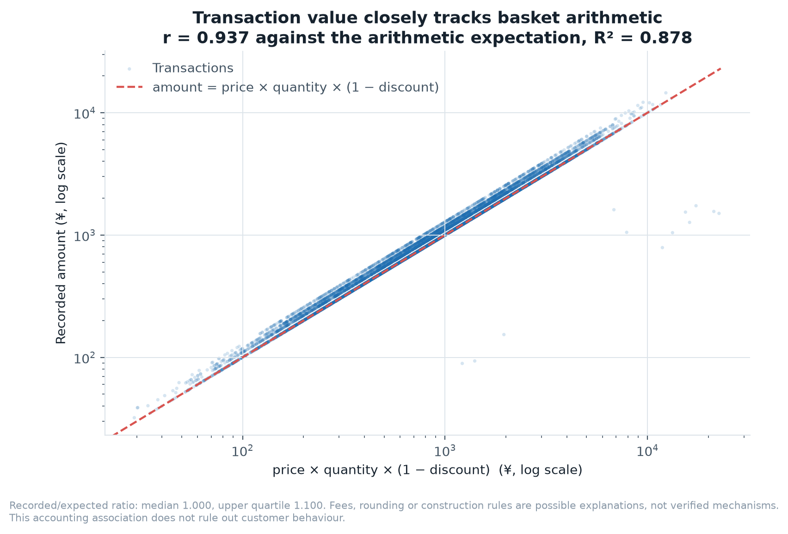
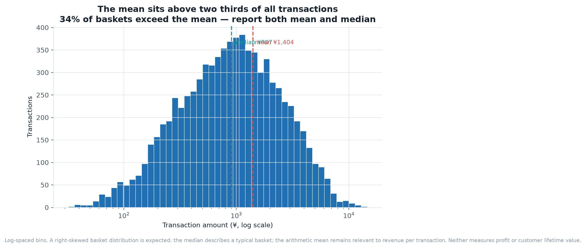
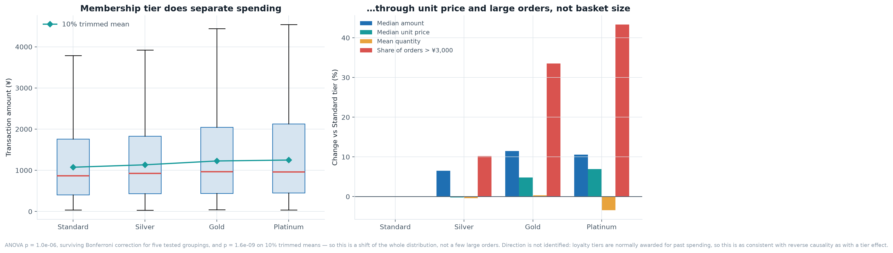
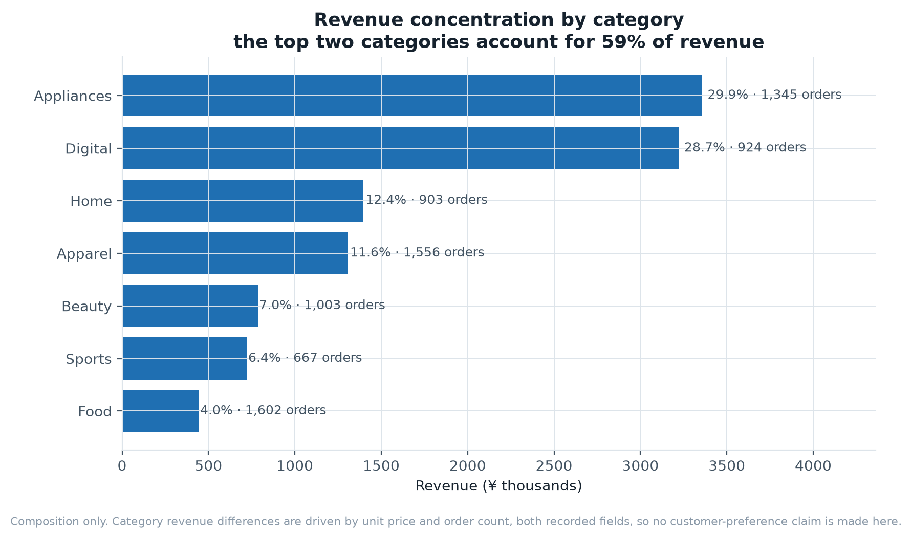
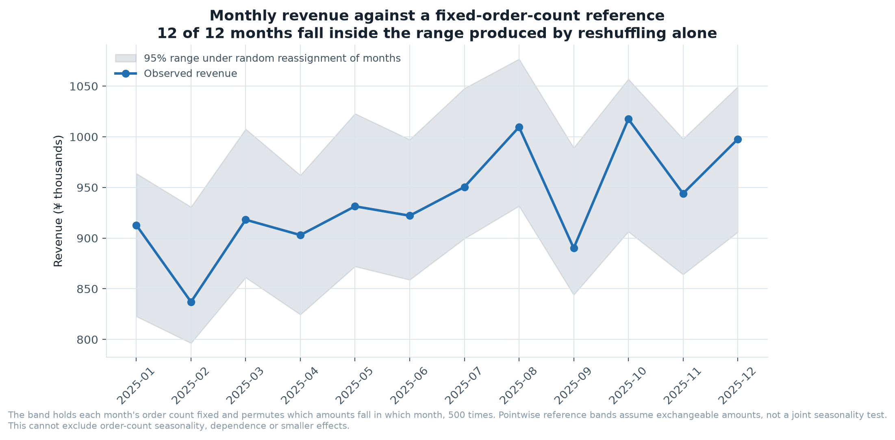

# Consumer Transactions: Evidence for a Segmentation Decision

**Author: 闫佳玉 / Jiayu Yan. Original coursework independently completed by the author.**

**8,020 raw rows → remove 20 exact duplicates →
8,000 analysed transactions. Non-significance does not prove equality.**

`Python` · `Matplotlib` · `ANOVA / Welch / Kruskal-Wallis / trimmed means`

## Business question and metric

Should a marketing team prioritise a demographic segment or a membership offer?
The primary metric here is **mean recorded amount per transaction** (sum of amount
divided by included transactions), relevant to revenue per order. Median amount
describes a typical order; a 10%-per-tail trimmed mean describes the central 80%.
These are different estimands. None measures margin, conversion, purchase frequency
or lifetime value. The unit is a transaction, not a customer.

## Evidence and statistical scope

The table uses the 8,000 deduplicated transactions, dropping
missing labels separately for each grouping; `n` is the included count.
4 of 5 primary ANOVA hypotheses are
not rejected at Bonferroni 0.05/5 = 0.01. This does not prove no difference or
establish that any segment is commercially equivalent.

| Grouping | n | ANOVA p | ANOVA adjusted p | Welch p | Kruskal-Wallis p | Trimmed Welch-Yuen p | Primary decision |
| --- | ---: | ---: | ---: | ---: | ---: | ---: | --- |
| Age band | 8,000 | 0.445 | 1 | 0.363 | 0.693 | 0.542 | not rejected |
| Gender | 8,000 | 0.522 | 1 | 0.523 | 0.783 | 0.938 | not rejected |
| City tier | 8,000 | 0.773 | 1 | 0.773 | 0.303 | 0.58 | not rejected |
| Payment method | 7,985 | 0.896 | 1 | 0.892 | 0.439 | 0.722 | not rejected |
| Membership tier | 8,000 | 1.04e-06 | 5.2e-06 | 1.33e-05 | 0.000112 | 0.000355 | reject equal means (nominal) |

**These are nominal, exploratory transaction-level tests.** There are
3,997 unique user IDs and
2,372 IDs with repeated transactions.
Independence is therefore unverified for these transaction-level tests.
P-values and confidence intervals must not be treated as calibrated customer-level
evidence or as causal estimates.

- **ANOVA** asks whether arithmetic means are equal. The classical F reference
  assumes independent errors, common within-group variance and normal errors for
  exact finite-sample inference. Large groups can help the mean approximation under
  finite variance, but do not remove skew, heteroskedasticity or dependence.
  Group sizes, variance ratios and median-centred Levene (Brown-Forsythe) p-values
  are exported as diagnostics; a non-significant diagnostic does not prove assumptions.
- **Welch ANOVA** also targets means and relaxes equal variances. Its p-value is an
  approximation and it still requires independent observations.
- **Kruskal-Wallis** is a rank-based test of equality of group distributions.
  A location/median interpretation requires comparable distribution shapes;
  different spread or shape can change the result. It is not a robust test of
  the same arithmetic-mean null.
- **Welch-Yuen** tests equality of 10%-per-tail trimmed means using winsorised
  variances and retained sample sizes. It checks sensitivity to extremes and
  changes the estimand; it does not prove a shift of the entire distribution.
- **Multiplicity:** the five primary ANOVA tests form one Bonferroni family.
  Each sensitivity family also has five-test adjusted p-values in the CSV, but
  there is no joint correction over all methods. Sensitivity checks are exploratory,
  not extra opportunities to declare a discovery. Omnibus rejection does not
  identify which tiers differ; no pairwise comparisons are claimed from omnibus tests.
- **Figure intervals:** IID bootstrap mean intervals and Fisher-z correlation intervals are
  pointwise and assume independent observations. They are not simultaneous,
  cluster-adjusted or pairwise difference intervals. Overlap is not a hypothesis test.



## User-cluster bootstrap sensitivity

The target is the **difference in transaction-weighted arithmetic mean amount**
(comparison minus reference), not the equal-weighted mean of customer means.
For each of 2,000 draws, sample all 3,997
unique user IDs with replacement. Each selected ID contributes all its transactions,
including records in different groups, with the same multiplicity in every group.
Recompute each mean as total amount / transaction count. Group counts may vary.
Missing labels are excluded only from that grouping's means; all users remain in
the sampling frame. Seed: 20261013; the local RNG is independent of plotting calls.

Within-group customer averaging followed by independent-group ANOVA/Welch was
removed: it changes weighting and does not resolve dependence across groups.
The cluster bootstrap permits dependence within a user, including across groups,
but assumes independent, representative user clusters and reliable IDs.
It does not address dependence between users, selection or confounding.

| Grouping | Comparison − reference | Difference (¥/transaction) | Pointwise 95% CI | Users crossing groups | Valid draws |
| --- | --- | ---: | --- | ---: | --- |
| Age band | 26-35 − 18-25 | 73.56 | [-25.05, 177.13] | 1965 | 2000/2000 |
| Age band | 36-45 − 18-25 | 54.47 | [-40.71, 153.56] | 1965 | 2000/2000 |
| Age band | 46-55 − 18-25 | 32.76 | [-81.52, 153.17] | 1965 | 2000/2000 |
| Age band | 56+ − 18-25 | -80.53 | [-272.50, 122.42] | 1965 | 2000/2000 |
| Age band | 36-45 − 26-35 | -19.09 | [-101.35, 63.48] | 1965 | 2000/2000 |
| Age band | 46-55 − 26-35 | -40.80 | [-145.75, 65.56] | 1965 | 2000/2000 |
| Age band | 56+ − 26-35 | -154.09 | [-335.82, 40.03] | 1965 | 2000/2000 |
| Age band | 46-55 − 36-45 | -21.71 | [-125.69, 84.24] | 1965 | 2000/2000 |
| Age band | 56+ − 36-45 | -135.00 | [-321.07, 45.69] | 1965 | 2000/2000 |
| Age band | 56+ − 46-55 | -113.29 | [-310.21, 89.18] | 1965 | 2000/2000 |
| Gender | Male − Female | 21.12 | [-41.38, 84.24] | 1482 | 2000/2000 |
| City tier | Tier 1 − New Tier 1 | -35.53 | [-137.06, 65.12] | 1983 | 2000/2000 |
| City tier | Tier 2 − New Tier 1 | -36.21 | [-114.49, 47.21] | 1983 | 2000/2000 |
| City tier | Tier 3+ − New Tier 1 | -2.52 | [-85.60, 87.62] | 1983 | 2000/2000 |
| City tier | Tier 2 − Tier 1 | -0.69 | [-101.25, 99.01] | 1983 | 2000/2000 |
| City tier | Tier 3+ − Tier 1 | 33.01 | [-70.94, 135.59] | 1983 | 2000/2000 |
| City tier | Tier 3+ − Tier 2 | 33.69 | [-56.33, 119.98] | 1983 | 2000/2000 |
| Payment method | Credit card − Alipay | 21.06 | [-86.84, 116.40] | 1948 | 2000/2000 |
| Payment method | Debit card − Alipay | -24.21 | [-119.67, 81.59] | 1948 | 2000/2000 |
| Payment method | WeChat Pay − Alipay | 3.91 | [-75.49, 87.16] | 1948 | 2000/2000 |
| Payment method | Debit card − Credit card | -45.27 | [-153.42, 71.72] | 1948 | 2000/2000 |
| Payment method | WeChat Pay − Credit card | -17.15 | [-110.83, 79.71] | 1948 | 2000/2000 |
| Payment method | WeChat Pay − Debit card | 28.12 | [-73.36, 118.86] | 1948 | 2000/2000 |
| Membership tier | Platinum − Gold | 25.20 | [-143.12, 202.00] | 1776 | 2000/2000 |
| Membership tier | Silver − Gold | -168.57 | [-266.04, -67.94] | 1776 | 2000/2000 |
| Membership tier | Standard − Gold | -215.54 | [-309.62, -119.73] | 1776 | 2000/2000 |
| Membership tier | Silver − Platinum | -193.76 | [-364.42, -30.08] | 1776 | 2000/2000 |
| Membership tier | Standard − Platinum | -240.74 | [-402.66, -86.89] | 1776 | 2000/2000 |
| Membership tier | Standard − Silver | -46.98 | [-123.73, 27.51] | 1776 | 2000/2000 |

All observed pairs are exported, without selecting them by their results.
These exploratory percentile intervals are not simultaneous or multiplicity-adjusted;
they provide no omnibus p-value or confirmatory pairwise discoveries.
An interval containing zero does not establish equivalence; excluding zero does
not establish causality or commercial relevance. If any draw has an empty member
of a pair, its interval is withheld (CSV blank / JSON null), with valid-draw counts.
`outputs/07_user_cluster_sensitivity.csv` and `user_cluster_sensitivity` in
`outputs/findings.json` contain matching estimates, intervals, denominators,
cross-group user counts, seed and draw status. The original tests and figure
intervals above remain nominal; this separate sensitivity does not calibrate them.

## Linear associations and basket arithmetic

| Variable | Pairwise-complete n | Pearson r | Nominal 95% Fisher-z CI |
| --- | ---: | ---: | --- |
| Monthly income | 7,985 | -0.010 | [-0.032, +0.012] |
| Age | 8,000 | -0.001 | [-0.023, +0.021] |
| Discount rate | 8,000 | +0.003 | [-0.019, +0.025] |
| Rating | 7,985 | +0.014 | [-0.008, +0.036] |
| Quantity | 8,000 | +0.372 | [+0.353, +0.391] |
| Unit price | 8,000 | +0.762 | [+0.753, +0.771] |

Near-zero estimates constrain plausible **linear** correlations under the sampling
assumptions. Intervals containing zero do not demonstrate absence of association;
nonlinear patterns, confounding and causal effects remain unresolved.



Recorded amount tracks `price × quantity × (1 − discount)` with
r = 0.937, R² = 0.878.
The recorded/expected ratio has median 1.000 and upper
quartile 1.100. Fees or dataset construction rules are hypotheses,
not verified mechanisms. Basket arithmetic does not exclude customer behaviour.




## Membership association and commercial meaning

Mean amount is ¥1,338.04 for Standard and
¥1,578.78 for Platinum, a descriptive difference of
¥240.74 per transaction.
Membership omnibus p-values are ANOVA 1.04e-06,
Welch 1.33e-05, Kruskal-Wallis 0.000112 and
trimmed Welch-Yuen 0.000355; they address different nulls.
These omnibus p-values are neither an adjusted Standard–Platinum pairwise test
nor an upgrade effect. The separate cluster interval above is pointwise only.

Membership is a candidate for further investigation, not a reason to spend more
on upgrades. Tier eligibility may depend on prior spending, and the assignment
rule is undocumented. Selection, confounding and reverse causality remain possible.
The top two categories contribute 58.5%
of recorded revenue; inspect their margins and inventory exposure before allocating
budget. Revenue concentration alone does not establish customer preference or profit.




## Monthly reference and its limits

12 of 12 months lie within
pointwise 95% reference bands from 500 reassignments of amounts while holding each
month's order count fixed. This is not a joint seasonality test and cannot exclude
seasonality in order counts, dependence or smaller effects. Exchangeability is an
assumption; a single teaching-data year is insufficient for a general seasonal policy.



## Decision and next experiment — proposed, not performed

1. **Current decision:** do not prioritise demographic targeting solely from these
   unadjusted rankings. Keep membership as a hypothesis and first validate user IDs,
   tier assignment timing, missing labels and the amount definition on production data.
2. **Observational follow-up:** construct customer histories, define a fixed
   follow-up window, audit dependence and selection, and use customer-cluster
   inference. Specify a commercially meaningful effect before any equivalence claim.
3. **Proposed experiment:** randomise eligible customers to a defined membership
   offer or existing experience, stratifying on pre-treatment spending/tier where
   appropriate. Do not infer the offer effect by comparing existing tiers.
4. **Primary decision metric:** incremental contribution margin per randomised
   eligible customer over the pre-specified window, including non-purchasers and
   offer costs. Track conversion, repeat purchase and order value as secondary
   metrics; refunds, unsubscribes and discount expense are guardrails.
5. **Decision rule:** agree a minimum worthwhile margin gain, guardrail limits,
   sample size/power, follow-up period and multiplicity plan before launch. Analyse
   by assigned group (intention to treat); expand only if the interval supports the
   agreed economic threshold and guardrails, otherwise revise or gather more evidence.

No A/B test, random assignment or causal identification was performed in this project.
The current data lacks the cost and eligibility fields needed to estimate that payoff.

## Data provenance and reproducibility

The course-supplied source has **8,020 raw rows**, including
**20 exact duplicate rows**. All reported analyses use the
**8,000 deduplicated transactions**; missing values are not
globally imputed. Raw missing counts: `income`: 15, `payment`: 15, `rating`: 15. Dates span
2025-01-01 to 2025-12-31. The generating process and upstream vendor
are undocumented. Results illustrate an analysis workflow, not real-market claims.

From this project directory, in the centrally prepared Python environment:

```bash
python src/analyze.py
python -m unittest discover -s tests -v
```

The build rewrites seven PNG figures, seven CSV tables, `outputs/findings.json` and
this README via `render_readme()`. A seed of 20261013 is reset at each full run;
reproducibility also depends on dependency versions. Reports/PNG figures can be
viewed offline. Original coursework is retained in `source_materials/`; source data
is unmodified. AI participated in analysis design, code, interpretation and
English writing. Tests, intervals and methodological revisions are portfolio
extensions, not claimed as independently designed original coursework.
