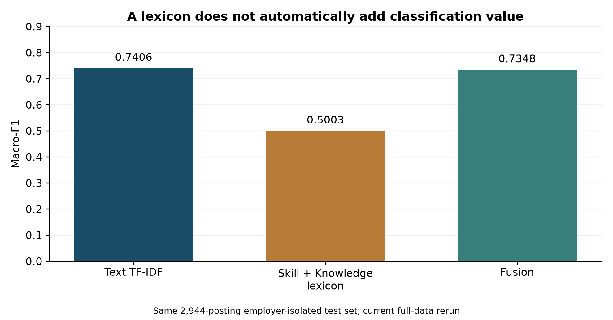
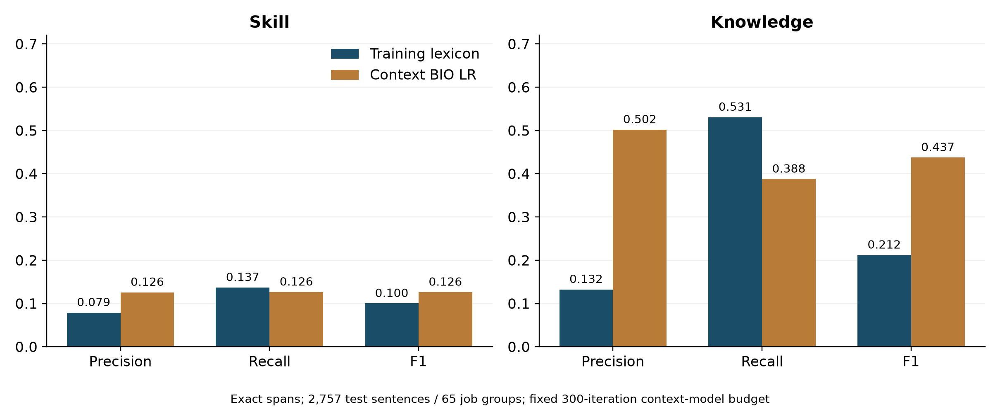

# Does the Skill Signal Help?

### Job-posting classification and skill extraction, evaluated separately

[Read the research brief](https://jiayuyan117.github.io/academic-portfolio/projects/08-nlp-job-postings/report.html)
· [Data card](DATA_CARD.md) · [Methods and evidence](METHODS.md)
· [Contribution statement](CONTRIBUTIONS.md)


An employer-isolated study of **21,663 English job advertisements across 20
SEEK categories**, paired with a separate exact-span evaluation on SkillSpan.
The question is whether a training-only **Skill + Knowledge phrase lexicon**
adds useful information to a strong text classifier.

The study distinguishes two decisions: which broad category a posting belongs
to, and which requirements can be extracted accurately from its sentences.
Category accuracy does not establish the quality of a skills explanation.

## What to read

1. [Research brief](report.html): question, measured results, decision implications
   and explicit evidence limits.
2. [Generated metrics](results/metrics.json): current run values and the original
   paper's reported values, labelled separately.
3. [Data card](DATA_CARD.md): fixed sources, cohort selection and group isolation.
4. [Prediction files](results/): inspect and independently recompute the results.




## Research design

| Question | Design | Interpretation limit |
| --- | --- | --- |
| Does the lexicon improve classification? | Text, lexicon and equal-weight concatenation; validation-selected LinearSVC; common held-out employers | This lexicon and fusion rule, not all skill representations |
| Is the difference practically meaningful? | +0.02 Macro-F1 criterion and paired employer-cluster bootstrap | Criterion appears in supplied code; no timestamped public preregistration was supplied |
| Can requirements be extracted accurately? | Training lexicons versus contextual BIO logistic regression; Skill/Knowledge scored independently | Exact-span performance on two public English benchmark sources |
| Does representation choice matter? | Fixed-sample TF-IDF, three-epoch TextCNN and frozen MiniLM + LR | Different truncation and compute budgets; no causal ranking of model families |
| Does the result transfer to another market? | Historical exploratory JobStreet comparison | Original external inputs and exclusion index are absent; not rerun in this release |

Macro-F1 gives equal weight to the fixed category set. Clustered intervals
condition on the fitted models; they do not measure training-seed uncertainty.
An interval containing zero is not evidence that the true effect is exactly zero.

## Reproduce

Use a separate CPython 3.12 environment from this directory:

```bash
python -m venv .venv
# Activate .venv for your operating system.
python -m pip install -r requirements.txt
python run.py verify          # recompute committed predictions and check integrity
python run.py smoke           # train the small real-data sample; separate outputs
python run.py data            # download fixed sources; verify hashes; reconstruct cohort
python run.py reproduce       # full classification + extraction, intervals and figures
python run.py verify --full   # also verify all predictions against full source labels
```

`make setup`, `make data`, `make reproduce` and `make verify` are equivalent
convenience targets. Windows does not need Make; `run.py` is the primary entry.
The 1,200-posting sample is a pipeline test, **not** the research evaluation.
It preserves the delivered split membership and all 20 categories.

For the optional neural comparison:

```bash
python -m pip install -r requirements-deep.txt
python src/model_comparison.py --models tfidf cnn minilm
python src/model_comparison.py --stage verify
python src/build_report.py
```

MiniLM downloads the pinned model revision on its first run. Full CPU training
takes substantially longer than verification. Original and rerun results can
differ across numerical libraries and training hardware; metrics are recomputed
from each run's saved predictions, not forced to equal the paper.

## What is independently checkable

- Every supplied posting maps to fixed public source rows through a compact
  cohort ledger. **22,213 source references** cover the 21,663 deduplicated
  postings.
- SHA-256 identifiers use **lowercased normalized text**, not the original
  unmodified advertisement bytes.
- Train/validation/test sizes are **15,667 / 3,052 / 2,944**, with zero normalized
  employer-group intersection. This does not rule out unidentified corporate
  aliases, recruitment-agency clients or near-duplicate templates.
- SkillSpan retains **4,800 / 3,174 / 3,569** official sentences. Removing
  evaluation sentences seen verbatim in training leaves **2,515 / 2,757**
  validation/test sentences. The test contains 65 source/job groups.
- Committed predictions contain identifiers, labels and span boundaries rather
  than full job descriptions. Verification checks saved metrics and paired
  bootstrap results without fitting a model or overwriting expected values.

## From evidence to a decision

For a job-board taxonomy, retain the strong text baseline unless a candidate
feature set clears a stated gain threshold under a relevant evaluation design.
For curriculum planning or job-search support, present extracted phrases as
source-linked candidates for human review. Low exact-span precision makes an
automated skills profile unsuitable for individual hiring decisions.

A useful next study would remove generic lexicon terms using training data
only, compare alternative fusion weights on validation data, and evaluate the
chosen design once on a new employer/time holdout. This is a proposed extension,
not a completed experiment or a causal claim.

## Attribution and scope

This is a portfolio adaptation of a **team coursework study** credited in the
source paper to **闫佳玉, 凌泳婷 and 王安娜**, supervised by **梁沛**.
Individual original contributions are not itemized in the supplied materials;
sole authorship is not claimed. See [CONTRIBUTIONS.md](CONTRIBUTIONS.md).

The public integration adds English documentation, configurable execution,
fixed-source reconstruction, independent checks and generated reports with AI
assistance. It is coursework research, not a peer-reviewed publication.
Dataset permissions and upstream attributions are separate from the
[implementation license](LICENSE). See [THIRD_PARTY_NOTICES.md](THIRD_PARTY_NOTICES.md).
