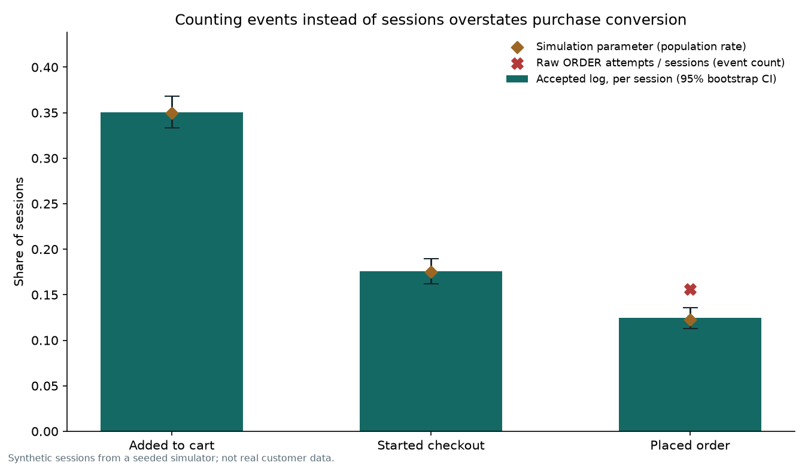
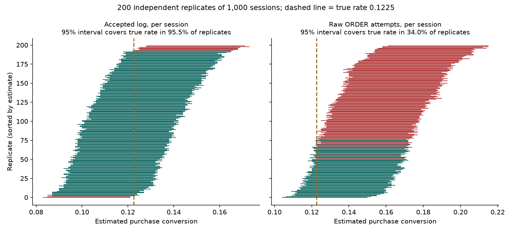
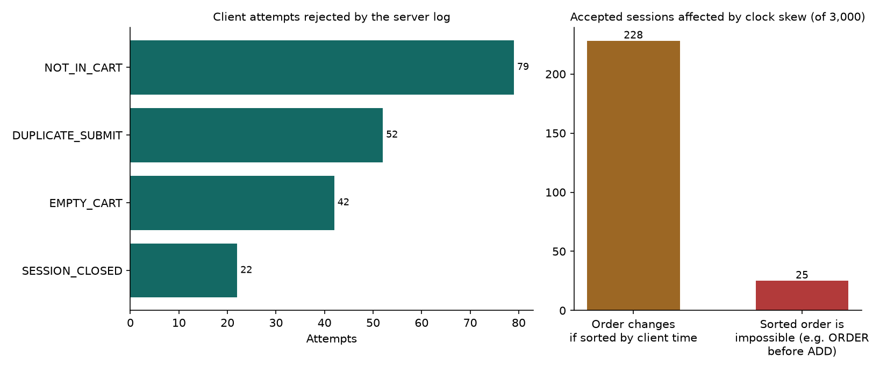

# 11 · Counting Sessions, Not Clicks: Cart Event Logs and Funnel Conversion

`Java 17` · `idempotent event log` · `seeded simulation with known truth` · `session bootstrap` · `interval coverage study`

**Question.** A shop wants its purchase conversion rate from a cart event log.
Clients retry order submissions, clocks drift and some requests are invalid.
Which counting rule recovers the true rate, and how would we know?

**Answer on simulated data.** Counting raw ORDER attempts per session reports
**15.6%** purchase conversion. The server-validated log, counted once per session,
reports **12.47%** (95% bootstrap CI **[11.30%, 13.60%]**) against a true
simulated rate of **12.25%**. Across 200 independent replicates, the session
interval covers the true rate **95.5%** of the time; the event-count interval
covers it only **34.0%** of the time, with a mean bias of **+3.16 percentage points**.

All data are synthetic. The study validates a measurement pipeline against a
known answer; it says nothing about real customers.

## Design

The topic starts from two chapters of a Java Web textbook: a session shopping
cart (chapter 04) and request logging with filters (chapter 08). No textbook
code is copied or redistributed. This project goes further in three ways:

1. **Server-side validation** (`java/src/CartEventLog.java`). Every client
   attempt is accepted with a server sequence number or rejected with a reason:
   repeated order key, empty cart, removing items not held, events after the
   order, invalid quantity or price. Order totals use integer cents.
2. **Simulation with known truth** (`java/src/Simulate.java`). 3,000 seeded
   sessions follow fixed funnel probabilities (add 0.35, checkout | add 0.50,
   order | checkout 0.70) with injected faults: 15% repeated submits, 4% clock
   skew of up to 30 s, invalid removals, empty-cart orders and late events.
   The true outcome of every session is written to `data/truth_sessions.csv`.
3. **Analysis that checks itself** (`analysis/analyze.py`). Funnel shares are
   computed per session from accepted events, with intervals from resampling
   whole sessions. The same estimators are then rerun on 200 independent
   replicates of 1,000 sessions to measure how often each interval covers the
   true rate.

## Results

| Measure | Value |
| --- | --- |
| Client attempts → accepted + rejected | 12,524 → 12,329 + 195 |
| Sessions where accepted-log stage flags differ from truth | **0 of 3,000** |
| Added to cart / started checkout / placed order | 35.07% / 17.60% / 12.47% |
| Step conversion: checkout given add; order given checkout | 50.19%; 70.83% (true 50%; 70%) |
| Raw ORDER attempts per session | 15.60% (+3.13 pp vs session count) |
| Interval coverage over 200 replicates: session / event count | 95.5% / 34.0% |
| Sessions whose order changes if sorted by client time | 228 |
| …of which the sorted order is impossible (e.g. ORDER before ADD) | 25 |







**Decision relevance.** Report conversion per session from a validated log,
and order events by server sequence rather than client timestamps. Deduplicating
at write time with an idempotency key is cheaper and safer than repairing counts
afterwards.

## Limitations

- Every session is independent, and every fault rate is a fixed assumption.
  Real traffic has returning users, bots, multi-device sessions and lost events,
  none of which is modelled.
- The 95.5% coverage confirms the percentile bootstrap behaves as expected for
  a simple proportion at n = 1,000. It does not validate the method for rarer
  events or clustered users.
- The event log runs in memory in one process; there is no persistence,
  concurrency control or HTTP layer here (see project 10 for those).

## Reproduce

Requires JDK 17+ and Python 3.12 with `requirements.txt` installed. From this directory:

```powershell
powershell -NoProfile -ExecutionPolicy Bypass -File .\run.ps1
```

The script compiles the Java code, runs 9 Java test groups, regenerates all
data with the fixed seed, reruns the analysis and checks 6 invariants on
`results/findings.json`. Two consecutive runs produced byte-identical findings.
Verified locally on Windows with Temurin 21 (`--release 17`) and CPython 3.12;
no CI workflow covers this project. `data/replicate_sessions.csv` (2.5 MB) is
regenerated by the script and not committed.

## Authorship and AI use

Built for Jiayu Yan's portfolio with substantial AI assistance in design,
code, analysis and writing. The textbook supplied only the topic.

## 中文说明

以教材第 4 章购物车和第 8 章日志过滤器为选题，未复制教材代码。Java 端对每次客户端请求
做校验并记录拒绝原因（重复下单、空购物车、删除不存在的商品等），模拟器生成已知真实
答案的 3,000 个会话。按"原始下单事件数"计算的转化率为 15.6%，按"会话 + 已验证日志"
计算为 12.47%，真实值 12.25%。200 次独立重复实验中，会话口径的 95% 区间覆盖真实值
95.5%，事件口径只有 34.0%。所有数据均为模拟数据，不代表真实用户。项目在 AI 大量
辅助下完成。
